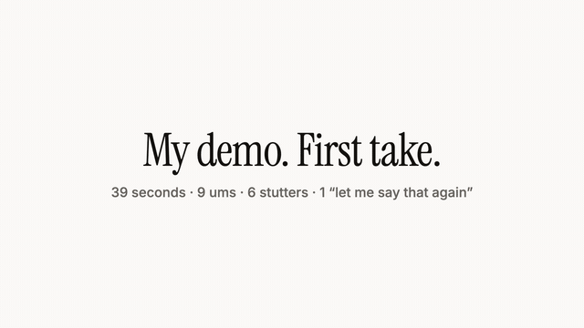
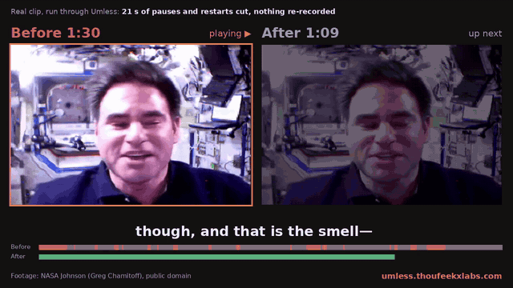

<p align="center"></p>

# Umless

**Record once, post today.** Umless is an open-source command-line tool that cuts ums, stutters, retakes and dead air out of talking-head video and demo recordings. On our test take it turned **39.4 s into 17.5 s**: 9 ums, 6 stutters and one "let me say that again" removed, with no clicks at the cuts.

[Quick start](#quick-start) · [Use it from AI agents (MCP)](#use-it-from-ai-agents-mcp-server-and-claude-skill) · [How it works](#how-it-works) · [Hosted version](https://umless.thoufeekxlabs.com/?ref=github) · [Report a bad cut](https://github.com/thoufeekx/umless/issues/new)

If Umless saves you an editing session, a ⭐ helps other people find it.

## Quick start

You need Node 20+, `ffmpeg` on your PATH and an [OpenRouter key](https://openrouter.ai/keys). A 3-minute video costs about $0.02 in API calls.

```bash
export OPENROUTER_API_KEY=...
npx -y github:thoufeekx/umless my-video.mp4          # writes my-video.umless.mp4
npx -y github:thoufeekx/umless my-video.mp4 --score  # Um Score only, no render
```

The first run builds the CLI from GitHub, so it takes a minute; later runs are cached. (`npx umless` without the `github:` prefix will work once the package is on npm.) From a clone:

```bash
git clone https://github.com/thoufeekx/umless && cd umless && npm install
npx tsx cli/umless.ts my-video.mp4
```

The terminal prints an Um Score (ums per minute, stutters and retakes, seconds of dead air), your transcript with every cut word struck through, and the before/after length. Audio files work too and come out as `.m4a`.

## What it cuts

- **Filler words:** um, uh, er and similar. The transcriber keeps every "um" (many speech-to-text models silently drop them).
- **Stutters and repeated phrases:** "the the", "so so so".
- **Retakes and false starts:** say a sentence twice and it keeps the last clean one.
- **Dead air:** long pauses shrink to a natural 0.25 s.
- **Clean cuts:** every boundary snaps to the quietest 10 ms nearby, with 15 ms fades, so you don't hear clicks.

## On real footage

<p align="center"></p>

The 39 s test take above is scripted. Here are two unscripted clips from Wikimedia Commons, run through the same CLI with no hand edits:

| Clip | Before | After | What it cut |
|---|---|---|---|
| NASA astronaut Greg Chamitoff, "The Smell of Space" (public domain) | 1:30 | 1:09 (−23%) | 1 restart, 1 false start, 1 repeat, 17.7 s of dead air |
| Mick Harvey, interviewed by Andrew McMillen (CC BY 3.0) | 1:30 | 0:54 (−40%) | 2 restarts, 1 repeat, 32.2 s of dead air |

On these clips the transcriber returned very few "um" tokens, so the savings come from restarts, repeats and pauses. Sources: [Chamitoff clip](https://commons.wikimedia.org/wiki/File:Ask_Astronaut_Greg_Chamitoff-_%27The_Smell_of_Space%27.webm) (NASA Johnson; no endorsement implied), [Harvey clip](https://commons.wikimedia.org/wiki/File:Mick_Harvey_(The_Bad_Seeds)_%27Talking_Smack_Honest_Conversations_About_Drugs%27.webm) (Andrew McMillen, CC BY 3.0, trimmed to 90 s and cut by Umless).

## Use it from AI agents: MCP server and Claude skill

`umless mcp` starts an [MCP](https://modelcontextprotocol.io) server on stdio with two tools:

| Tool | What it does | Returns |
|---|---|---|
| `analyze_video(path, retakes?)` | Transcribes and finds every cut, no render | `cuts[]` (`start`, `end`, `type`: filler / repeat / retake / silence, `text`, `reason`), `keep[]` segments, Um Score, counts, before/after duration |
| `clean_video(path, out?, options?)` | Renders the cleaned file (`options`: `retakes`, `studio_sound`) | output path, before/after duration, seconds saved, counts, the full cut list |

The server needs `ffmpeg` on the PATH and your `OPENROUTER_API_KEY` in its environment. Files are read from and written to the machine the server runs on.

**Claude Code**

```bash
claude mcp add umless -e OPENROUTER_API_KEY=$OPENROUTER_API_KEY -- npx -y github:thoufeekx/umless mcp
```

Or install the plugin, which adds the MCP server and the `umless` skill (so "remove the ums from demo.mp4" just works):

```
/plugin marketplace add thoufeekx/umless
/plugin install umless@umless
```

**Claude Desktop** (`claude_desktop_config.json`) and **Cursor** (`~/.cursor/mcp.json` or `.cursor/mcp.json`) use the same block:

```json
{
  "mcpServers": {
    "umless": {
      "command": "npx",
      "args": ["-y", "github:thoufeekx/umless", "mcp"],
      "env": { "OPENROUTER_API_KEY": "sk-or-..." }
    }
  }
}
```

**Skill only** (Claude Code, uses the CLI if the MCP server is not connected):

```bash
mkdir -p ~/.claude/skills/umless && curl -fsSL https://raw.githubusercontent.com/thoufeekx/umless/main/skills/umless/SKILL.md -o ~/.claude/skills/umless/SKILL.md
```

To check the server end to end on your machine: `node scripts/mcp-e2e.mjs testdata/demo_raw.mp4` (calls both tools over stdio).

## How it works

1. `ffmpeg` pulls the audio track.
2. ElevenLabs Scribe v2 (through OpenRouter) transcribes it word by word with timings. A second, cheap pass (Parakeet) finds the ums Scribe skipped, and each one is cut only where the audio shows a sound between two words.
3. Rules mark fillers and repeats, and an LLM (`gpt-5-mini` by default) marks retakes and false starts.
4. `ffmpeg` renders the kept segments into a new file.

Change the models with `UMLESS_STT_MODEL`, `UMLESS_FILLER_MODEL` (`off` disables the second pass) and `UMLESS_LLM_MODEL`. The pipeline is in [`lib/pipeline.ts`](lib/pipeline.ts), the CLI in [`cli/umless.ts`](cli/umless.ts), the cut-list layer in [`lib/cutlist.ts`](lib/cutlist.ts) and the MCP server in [`mcp/server.ts`](mcp/server.ts).

To try it before using your own footage, run it on `testdata/demo_raw.mp4`, a 39 s take with 9 ums, 6 stutters and a retake.

## Why open source

Most filler-word removers are closed. You can't see why a word was cut, and you pay per minute forever. With Umless you can read every rule, change the thresholds and run it in your own scripts and pipelines.

## Don't want a terminal?

- **[Umless hosted](https://umless.thoufeekxlabs.com/?ref=github):** upload in the browser, plus Studio Sound and re-voicing a clean script in your own voice. Join the waitlist.
- **[Done-for-you](https://umless.thoufeekxlabs.com/?ref=github):** send raw recordings and get finished edits back. Your first cleanup is free.

## Roadmap

- `npx umless` on npm (today: `npx github:thoufeekx/umless`)
- Timeline export (FCPXML / EDL) so you can finish in Premiere, Resolve, Final Cut or Kdenlive
- A `--json` cut list on the CLI (the MCP server already returns one)
- A local transcription option (whisper.cpp)

Want one of these sooner? Open an issue or send a PR.

## Contributing

Issues and PRs are welcome. If Umless cut something it shouldn't have, open an issue with the command you ran and the struck-through transcript it printed. Development and deploy notes for the hosted app are in [`docs/DEVELOPMENT.md`](docs/DEVELOPMENT.md).

## License

MIT © 2026 ThoufeekX Labs
